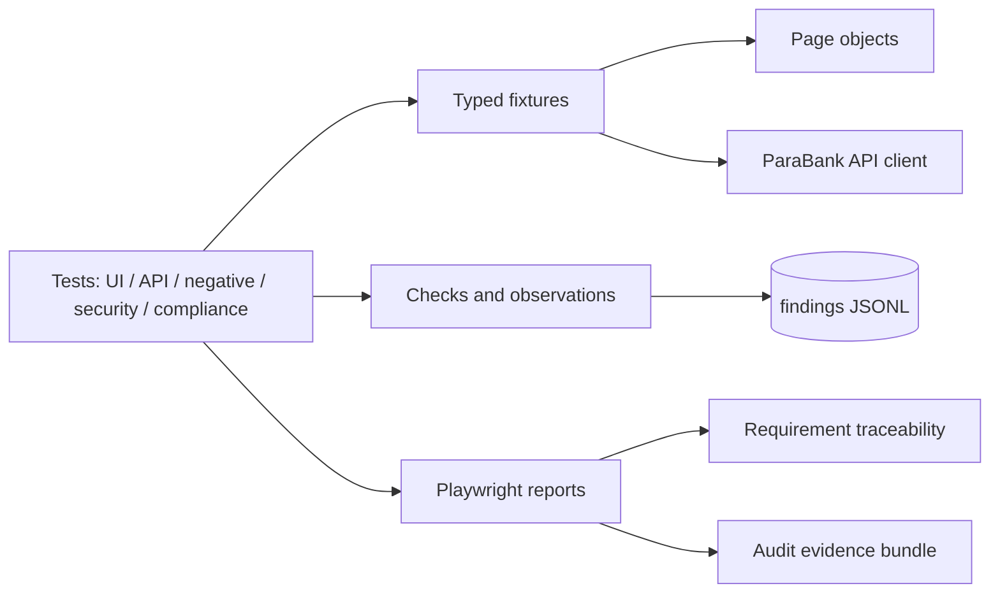

# Banking QA Automation

[](https://github.com/vilayatalimirza/banking-qa-playwright/actions/workflows/playwright.yml)

**Playwright + TypeScript test framework for the public ParaBank demo.** It tests money movement, financial invariants, account isolation, API behaviour, security controls, accessibility, resilience and auditability.

The focus is not just whether a button works. It is whether balances remain correct, one payment intent is applied once, customer data stays isolated, and failures can be explained with evidence.

## Project evidence

| Area | Current scope |
|---|---|
| Requirements | 24 risk-scored requirements across payments, security, compliance, accessibility and framework quality |
| Defect findings | 21 numbered BUG reports; confirmation state and evidence are recorded per finding |
| Compliance exercises | 2 separately labelled control gaps: PSD2 SCA and KYC validation |
| Expected-failure registry | 35 test titles across 20 identifiers (19 BUG IDs and GAP-001); GAP-002 is conditionally marked only when invalid SSN registration creates a customer |
| Test levels | Unit, page contract, UI E2E, API, hybrid, negative, resilience, security, accessibility, visual and compliance |

See [BUG-REPORTS.md](docs/BUG-REPORTS.md), [TEST-STRATEGY.md](docs/TEST-STRATEGY.md), and [TRACEABILITY.md](docs/TRACEABILITY.md). Two registered findings (BUG-006 and BUG-019) remain marked to-confirm. BUG-011 and BUG-020 are documented findings but are not currently registered as expected-failure guards.

## CI results and pass-rate methodology

Each GitHub Actions full-suite run generates a **run-specific metrics summary** in the workflow summary and audit-evidence artifact. It reports:

- **First-attempt pass rate:** tests that passed without retry.
- **Final pass rate:** tests that passed on the first attempt or passed after retry.
- **Flaky tests, unexpected failures, and defect guards that unexpectedly pass:** shown as separate counts.
- **Known-defect probes that fail as expected and skipped tests:** shown separately and excluded from the pass-rate denominator.

The published aggregate combines executions from the unit, full regression, Firefox, WebKit, Pixel 7 mobile smoke and visual-baseline-generation jobs. It reports first-attempt and eventual outcomes, keeps retry-passed tests marked as flaky, and excludes documented known-defect probes that fail as expected. The aggregate is an execution-level measure across CI jobs, not a count of unique test cases.

[View workflow runs and their per-run summaries](https://github.com/vilayatalimirza/banking-qa-playwright/actions/workflows/playwright.yml). Run artifacts include the merged HTML report and a SHA-256 audit-evidence bundle.

## Featured aggregate CI snapshot

The documented aggregate snapshot below comes from [workflow run #45, 18 November 2026](https://github.com/vilayatalimirza/banking-qa-playwright/actions/runs/44341598081), on commit `567a60d`. It is kept as the featured aggregate example and is not described as the newest workflow result.

**Aggregate CI execution pass rate: 89.3% (175/196).**

This aggregate combines test executions from the unit, full regression, Firefox smoke, WebKit smoke, Pixel 7 mobile smoke and visual-baseline-generation jobs. It counts executions across jobs, not unique test cases; a scenario exercised in more than one job is counted separately for each execution.

| CI job | Successful executions counted | Total executions counted | Notes |
|---|---:|---:|---|
| Unit tests | 109 | 109 | All passed |
| Full regression suite | 45 | 66 | 38 known-defect probes that failed as expected are excluded |
| Firefox smoke | 5 | 5 | 4 passed first try; 1 passed on retry and is still reported as flaky |
| WebKit smoke | 5 | 5 | All passed |
| Pixel 7 mobile smoke | 5 | 5 | All passed |
| Visual baseline generation | 6 | 6 | Snapshots generated with `--update-snapshots`; comparison was skipped |
| **Aggregate** | **175** | **196** | **89.3%** |

The calculation is `175 / 196 × 100 = 89.2857…%`, rounded to **89.3%**. The 38 expected known-defect probe failures are excluded from the denominator because those probes behaved as expected for already documented defects. The Firefox retry-passed test is counted as an eventual success and remains identified as flaky.

**Interpretation:** 89.3% is the combined CI execution pass rate for this portfolio summary. It is not a unique-test-case pass rate. It combines separate job executions, including browser smoke tests and successful baseline generation.

The unit-test job passed **109/109 unit tests**. The workflow's full regression jobs included failures in negative, E2E, hybrid and API coverage. The logs include HTTP 429 responses from the shared ParaBank demo, a missing Accounts Overview heading, and an account-row count mismatch. See the linked run for the job-level evidence and generated report.

The visual job generated six Linux baseline snapshots and uploaded them as an artifact. Its baseline-comparison step was skipped, so these six executions count as successful baseline generation in the aggregate, **not** as proof that visual comparison passed or that the snapshots were reviewed and committed.

## Newer workflow status

The latest completed workflow is [run #46, 18 November 2026](https://github.com/vilayatalimirza/banking-qa-playwright/actions/runs/44390733569). The overall workflow concluded with failures. The type-check and unit-test job passed (109/109), and the Firefox, WebKit, and Pixel 7 smoke jobs passed. The full-suite E2E, contract, hybrid, API, and negative jobs failed, as did the visual-regression job. The 89.3% figure above remains specifically tied to run #45; use run #46 for the newer execution evidence.

## Technology

- TypeScript, Node.js, Playwright Test
- Page Object Model and typed fixtures
- REST API testing and UI/API hybrid flows
- Integer-cent money utilities and financial invariants
- axe-core accessibility checks and visual regression
- GitHub Actions (validated workflow); a GitLab CI configuration is included but not yet validated on a GitLab runner
- JSON/JUnit/HTML reporting, requirement traceability and SHA-256 evidence manifests

## Architecture



## Run locally

```powershell
npm ci
npx playwright install chromium
npm run check
npm run test:full
npm run test:smoke
npm run test:cross-browser
npm run test:visual
```

Useful reports:

```powershell
npm run report:defects
npm run report:findings
npm run report:traceability
npm run report:metrics -- test-results/results.json
npm run report:evidence
```

More detail: [RUNBOOK.md](docs/RUNBOOK.md).

## Important limitations

- ParaBank is a shared public demo. It can reset, slow down or rate-limit requests. CI serializes demo-facing jobs and uses one worker per Chromium shard; preflight rejects HTTP errors and challenge pages before the suite starts. Retries are reported, not hidden.
- The complete automated regression suite runs in Chromium. Firefox, WebKit and Pixel 7 run the tagged critical smoke journeys only.
- The committed visual baselines were captured on Windows. Linux visual comparison is currently advisory until Linux baselines are captured and reviewed.
- This is not a real core-banking system. It does not expose a general ledger, end-of-day processing, real payment rails, sanctions screening or production identity verification.
- A passing automated accessibility scan is not proof of WCAG conformance; manual assistive-technology testing remains necessary.
- The GitLab CI YAML is included for portability but has not been validated with a GitLab-hosted pipeline. Published CI evidence currently comes from GitHub Actions.

The findings describe observed behaviour of this demo application, not vulnerabilities in a production bank. Some findings require confirmation, and the report states the evidence limits.

## About

QA engineer with 3+ years focused on software testing and automation, with a broader IT background. Current project work combines Java/Selenium experience with Playwright and TypeScript.

[GitHub](https://github.com/vilayatalimirza) · [LinkedIn](https://www.linkedin.com/in/vilayat-ali-mirza)
