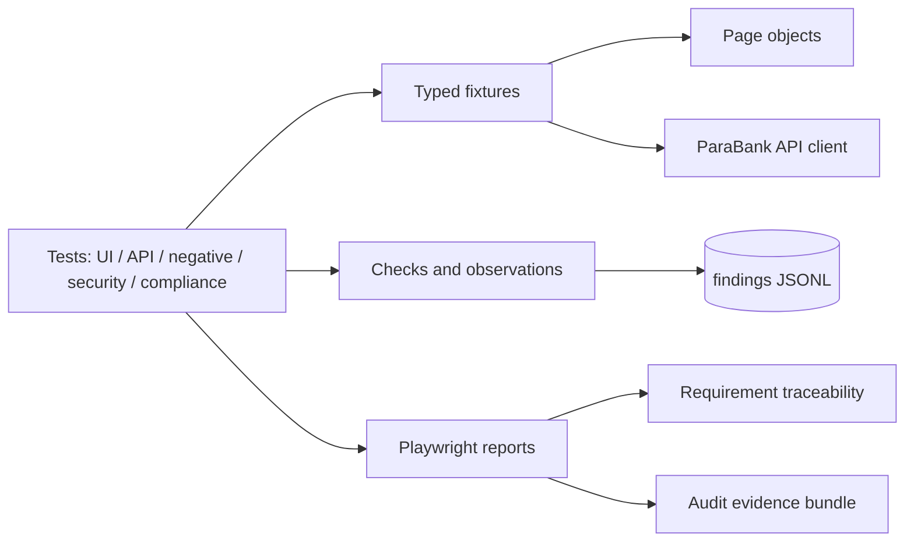

# Banking QA Automation

[](https://github.com/vilayatalimirza/banking-qa-playwright/actions/workflows/playwright.yml)

**Playwright + TypeScript test framework for the public ParaBank demo.** It tests money movement, financial invariants, account isolation, API behaviour, security controls, accessibility, resilience and auditability.

The focus is not just whether a button works. It is whether balances remain correct, one payment intent is applied once, customer data stays isolated, and failures can be explained with evidence.

## Project evidence

| Area | Current scope |
|---|---|
| Requirements | 24 risk-scored requirements across payments, security, compliance, accessibility and framework quality |
| Defect findings | 21 numbered BUG reports; confirmation state and evidence are recorded per finding |
| Compliance exercises | 2 separately labelled control gaps: PSD2 SCA and KYC validation |
| Expected-failure registry | 36 test titles across 21 identifiers (19 BUG IDs and 2 GAP IDs) |
| Test levels | Unit, page contract, UI E2E, API, hybrid, negative, resilience, security, accessibility, visual and compliance |

See [BUG-REPORTS.md](docs/BUG-REPORTS.md), [TEST-STRATEGY.md](docs/TEST-STRATEGY.md), and [TRACEABILITY.md](docs/TRACEABILITY.md). Two registered findings (BUG-006 and BUG-019) remain marked to-confirm. BUG-011 and BUG-020 are documented findings but are not currently registered as expected-failure guards.

## CI results and pass-rate methodology

Each GitHub Actions full-suite run generates a **run-specific metrics summary** in the workflow summary and audit-evidence artifact. It reports:

- **First-attempt pass rate:** tests that passed without retry.
- **Final pass rate:** tests that passed on the first attempt or passed after retry.
- **Flaky tests, unexpected failures, and defect guards that unexpectedly pass:** shown as separate counts.
- **Known-defect probes that fail as expected and skipped tests:** shown separately and excluded from the pass-rate denominator.

The metrics cover the merged **full Chromium suite**. Unit/typecheck, Firefox, WebKit, Pixel 7 smoke and visual jobs are separate CI jobs; they are not mixed into the Chromium pass rate. A retry-passed test improves the final rate but remains visible as flaky.

[View workflow runs and their per-run summaries](https://github.com/vilayatalimirza/banking-qa-playwright/actions/workflows/playwright.yml). Run artifacts include the merged HTML report and a SHA-256 audit-evidence bundle.

## Technology

- TypeScript, Node.js, Playwright Test
- Page Object Model and typed fixtures
- REST API testing and UI/API hybrid flows
- Integer-cent money utilities and financial invariants
- axe-core accessibility checks and visual regression
- GitHub Actions (validated workflow); a GitLab CI configuration is included but not yet validated on a GitLab runner
- JSON/JUnit/HTML reporting, requirement traceability and SHA-256 evidence manifests

## Architecture



## Run locally

```powershell
npm ci
npx playwright install chromium
npm run check
npm run test:full
npm run test:smoke
npm run test:cross-browser
npm run test:visual
```

Useful reports:

```powershell
npm run report:defects
npm run report:findings
npm run report:traceability
npm run report:metrics -- test-results/results.json
npm run report:evidence
```

More detail: [RUNBOOK.md](docs/RUNBOOK.md).

## Important limitations

- ParaBank is a shared public demo. It can reset, slow down or rate-limit requests. CI serializes demo-facing jobs and uses one worker per Chromium shard; retries are reported, not hidden.
- The complete automated regression suite runs in Chromium. Firefox, WebKit and Pixel 7 run the tagged critical smoke journeys only.
- The committed visual baselines were captured on Windows. Linux visual comparison is currently advisory until Linux baselines are captured and reviewed.
- This is not a real core-banking system. It does not expose a general ledger, end-of-day processing, real payment rails, sanctions screening or production identity verification.
- A passing automated accessibility scan is not proof of WCAG conformance; manual assistive-technology testing remains necessary.
- The GitLab CI YAML is included for portability but has not been validated with a GitLab-hosted pipeline. Published CI evidence currently comes from GitHub Actions.

The findings describe observed behaviour of this demo application, not vulnerabilities in a production bank. Some findings require confirmation, and the report states the evidence limits.

## About

QA engineer with 3+ years focused on software testing and automation, with a broader IT background. Current project work combines Java/Selenium experience with Playwright and TypeScript.

[GitHub](https://github.com/vilayatalimirza) · [LinkedIn](https://www.linkedin.com/in/vilayat-ali-mirza)
