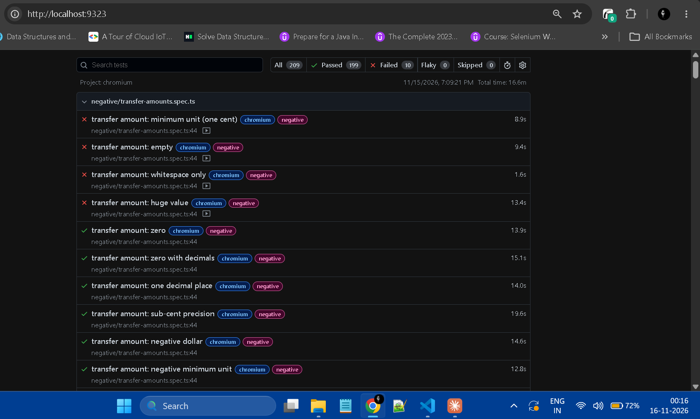
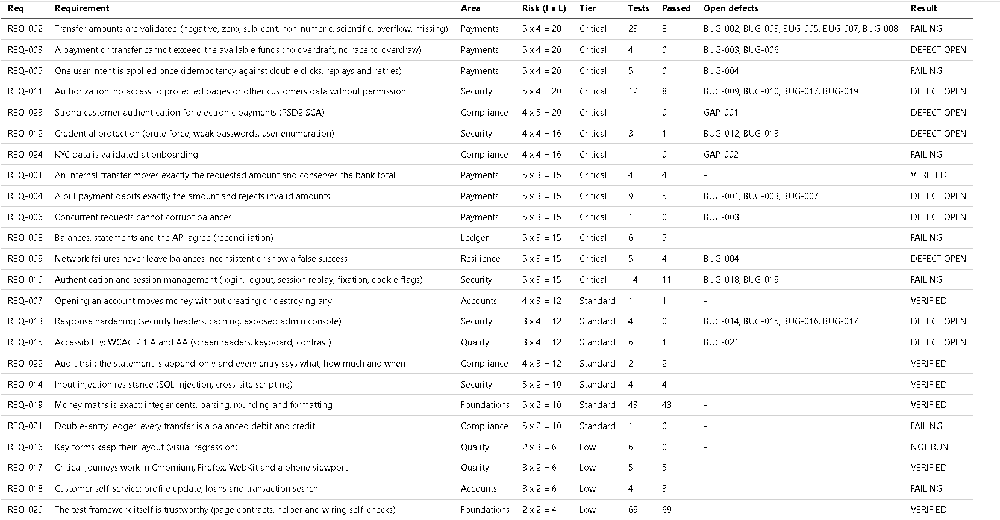
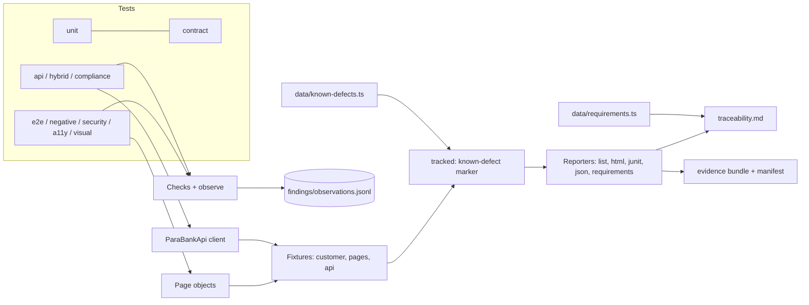

# banking-qa-playwright

A banking QA automation project: Playwright + TypeScript against the public demo bank [ParaBank](https://parabank.parasoft.com/parabank/).
It treats money rules as the thing under test (conservation of money, idempotency, reconciliation, double entry, double deductions) and documents **21 potential defect reports and 2 compliance gaps** from testing the demo. These are test-run findings, not a claim that every issue is currently reproducible; some remain observed or need confirmation. Confirmed examples include negative bill pay crediting the payer and an unauthenticated API transfer debiting another customer's account.

### Highlights
- **21 potential defects and 2 compliance gaps** documented in [docs/BUG-REPORTS.md](docs/BUG-REPORTS.md); some findings remain unconfirmed.
- **Money-first testing:** integer-cent maths, conservation of money, idempotency, reconciliation and double-entry checks.
- **Risk-based regression pack:** 24 requirements scored by impact × likelihood, with a [traceability matrix](docs/TRACEABILITY.md).
- **Audit evidence:** pipeline runs produce a hashed evidence bundle.
- **Shared-demo resilience:** known-defect tracking, retries with traces, and a [flaky-test log](docs/FLAKY-LOG.md).

**Stack**


**Coverage and platforms**


## Reports

| Test report | Requirement traceability |
|---|---|
|  |  |

The images are illustrative screenshots. GitHub Actions uploads the generated HTML report and an [audit-evidence bundle](scripts/evidence-bundle.ts) as run artifacts; GitLab CI archives its reports and test results. The committed [traceability matrix](docs/TRACEABILITY.md) is a static test-to-requirement listing unless generated with run results; it does not represent the latest test outcome.

## What it demonstrates

| Area | Where |
|---|---|
| Page objects + fixtures (`customer`, `pages`, `twoAccounts`, `secondUser`, `api`) | `pages/`, `fixtures/` |
| Money as integer cents (parse, format, round) with unit tests | `utils/money.ts`, `tests/unit/` |
| Invariants vs requirements (`Checks`, soft assertions), observed-behaviour log | `utils/checks.ts`, `utils/findings.ts` |
| API testing and hybrid UI + API flows | `api/`, `tests/api/`, `tests/hybrid/` |
| Negative, idempotency, concurrency, injection | `tests/negative/` |
| Network-failure and mocking scenarios | `tests/resilience/` |
| Security: sessions, brute force, headers, IDOR, fixation | `tests/security/` |
| Accessibility (axe-core, WCAG A/AA) and visual regression | `tests/a11y/`, `tests/visual/` |
| Compliance: double entry, audit trail, PSD2 SCA gap, KYC | `tests/compliance/` |
| Known-defect tracking (open bug = expected failure, fixed bug turns red) | `data/known-defects.ts`, `fixtures/tracked.ts` |
| Requirement traceability + risk-based tiers | `data/requirements.ts`, `docs/TRACEABILITY.md` |
| Audit-evidence bundle with SHA-256 manifest, one per pipeline run | `scripts/evidence-bundle.ts` |
| CI: GitHub Actions and GitLab CI, sharding, cross-browser smoke | `.github/workflows/`, `.gitlab-ci.yml` |

## Architecture



## How to run

```powershell
npm ci
npx playwright install chromium
npx tsc --noEmit                                   # type check
npx playwright test -c playwright.ci.config.ts --project=chromium tests/unit      # fast, offline
npx playwright test -c playwright.ci.config.ts --project=chromium                 # full suite against ParaBank
npx playwright test -c playwright.ci.config.ts --project=chromium --grep @smoke   # critical journeys
npx tsx scripts/defect-register.ts                 # open defects table
npx tsx scripts/summarize-findings.ts              # what the bank actually did
npx tsx scripts/traceability.ts                    # regenerate docs/TRACEABILITY.md
npx tsx scripts/evidence-bundle.ts                 # evidence/<run>/ after a run
```

More in [docs/RUNBOOK.md](docs/RUNBOOK.md).

## Reading the results

Green does not mean "the bank is correct". Tests for known defects are marked *expected to fail*: they pass while the bug exists and turn red ("Expected to fail, but passed") when it is fixed, so the register never rots. Every defect has a written report in `docs/BUG-REPORTS.md`.

## Folder structure

```
api/        REST client for ParaBank          pages/      page objects
fixtures/   test fixtures                     utils/      money, checks, findings, a11y, traceability
data/       factories, known defects, requirements
tests/      unit contract e2e negative api hybrid resilience security a11y visual compliance
reporters/  requirements reporter             scripts/    CLI tools (summaries, traceability, evidence)
docs/       strategy, plan, traceability, defects, concepts, flaky log
```

## Honest limits

ParaBank is a shared demo that resets and is rate-limited, so some runs show environmental flakes (see `docs/FLAKY-LOG.md`). It is not a real core banking system: there is no general ledger, EOD, interest accrual, SCA or sanctions screening to test, only what a customer can see.

## About the author
QA engineer (3 years, Selenium/Java moving to Playwright/TypeScript), focusing on banking and fintech testing.
[LinkedIn](https://www.linkedin.com/in/vilayat-ali-mirza)
