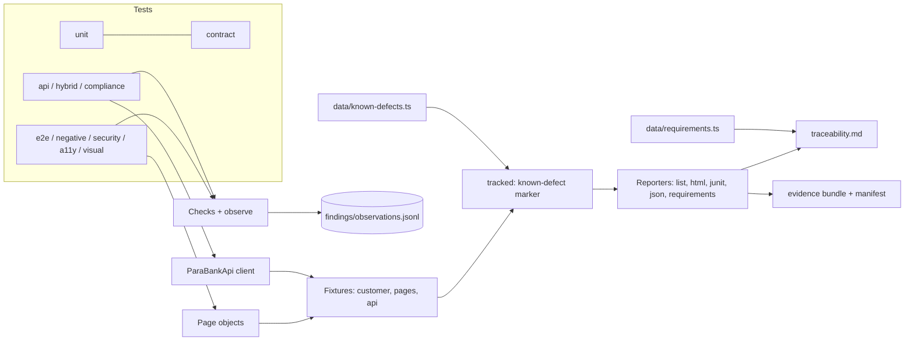

# banking-qa-playwright

A banking QA automation project: Playwright + TypeScript against the public demo bank [ParaBank](https://parabank.parasoft.com/parabank/).
It treats money rules as the thing under test (conservation of money, idempotency, reconciliation, double entry), and it **found and documented 22 real defects and gaps** in the demo, including critical ones (anonymous API transfer debits another customer, negative bill pay credits the payer, anonymous admin console).


> Replace `<your-user>` after you push. Add 2 screenshots to `docs/img/`: the HTML report and the CI job summary (requirement table).

## What it demonstrates

| Area | Where |
|---|---|
| Page objects + fixtures (`customer`, `pages`, `twoAccounts`, `secondUser`, `api`) | `pages/`, `fixtures/` |
| Money as integer cents (parse, format, round) with unit tests | `utils/money.ts`, `tests/unit/` |
| Invariants vs requirements (`Checks`, soft assertions), observed-behaviour log | `utils/checks.ts`, `utils/findings.ts` |
| API testing and hybrid UI + API flows | `api/`, `tests/api/`, `tests/hybrid/` |
| Negative, idempotency, concurrency, injection | `tests/negative/` |
| Network-failure and mocking scenarios | `tests/resilience/` |
| Security: sessions, brute force, headers, IDOR, fixation | `tests/security/` |
| Accessibility (axe-core, WCAG A/AA) and visual regression | `tests/a11y/`, `tests/visual/` |
| Compliance: double entry, audit trail, PSD2 SCA gap, KYC | `tests/compliance/` |
| Known-defect tracking (open bug = expected failure, fixed bug turns red) | `data/known-defects.ts`, `fixtures/tracked.ts` |
| Requirement traceability + risk-based tiers | `data/requirements.ts`, `docs/TRACEABILITY.md` |
| Audit-evidence bundle with SHA-256 manifest, one per pipeline run | `scripts/evidence-bundle.ts` |
| CI: GitHub Actions and GitLab CI, sharding, cross-browser smoke | `.github/workflows/`, `.gitlab-ci.yml` |

## Architecture



## How to run

```powershell
npm ci
npx playwright install chromium
npx tsc --noEmit                                   # type check
npx playwright test -c playwright.ci.config.ts --project=chromium tests/unit      # fast, offline
npx playwright test -c playwright.ci.config.ts --project=chromium                 # full suite against ParaBank
npx playwright test -c playwright.ci.config.ts --project=chromium --grep @smoke   # critical journeys
npx tsx scripts/summarize-findings.ts              # what the bank actually did
npx tsx scripts/defect-register.ts                 # open defects table
npx tsx scripts/traceability.ts                    # regenerate docs/TRACEABILITY.md
npx tsx scripts/evidence-bundle.ts                 # evidence/<run>/ after a run
```

More in `docs/RUNBOOK.md`.

## Reading the results

Green does not mean "the bank is correct". Tests for known defects are marked *expected to fail*: they pass while the bug exists and turn red ("Expected to fail, but passed") when it is fixed, so the register never rots. Every defect has a written report in `docs/BUG-REPORTS.md`.

## Folder structure

```
api/        REST client for ParaBank          pages/      page objects
fixtures/   test fixtures                     utils/      money, checks, findings, a11y, traceability
data/       factories, known defects, requirements
tests/      unit contract e2e negative api hybrid resilience security a11y visual compliance
reporters/  requirements reporter             scripts/    CLI tools (summaries, traceability, evidence)
docs/       strategy, plan, traceability, defects, concepts, flaky log
```

## Honest limits

ParaBank is a shared demo that resets and is rate-limited, so some runs show environmental flakes (see `docs/FLAKY-LOG.md`). It is not a real core banking system: there is no general ledger, EOD, interest accrual, SCA or sanctions screening to test, only what a customer can see. `docs/BANKING-CONCEPTS.md` says which concepts are tested and which are only discussed.
